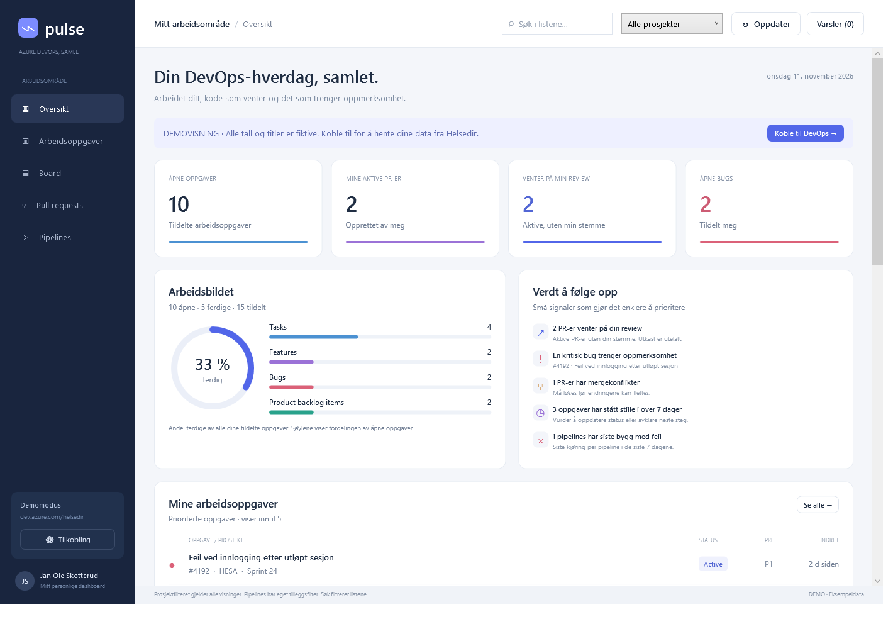
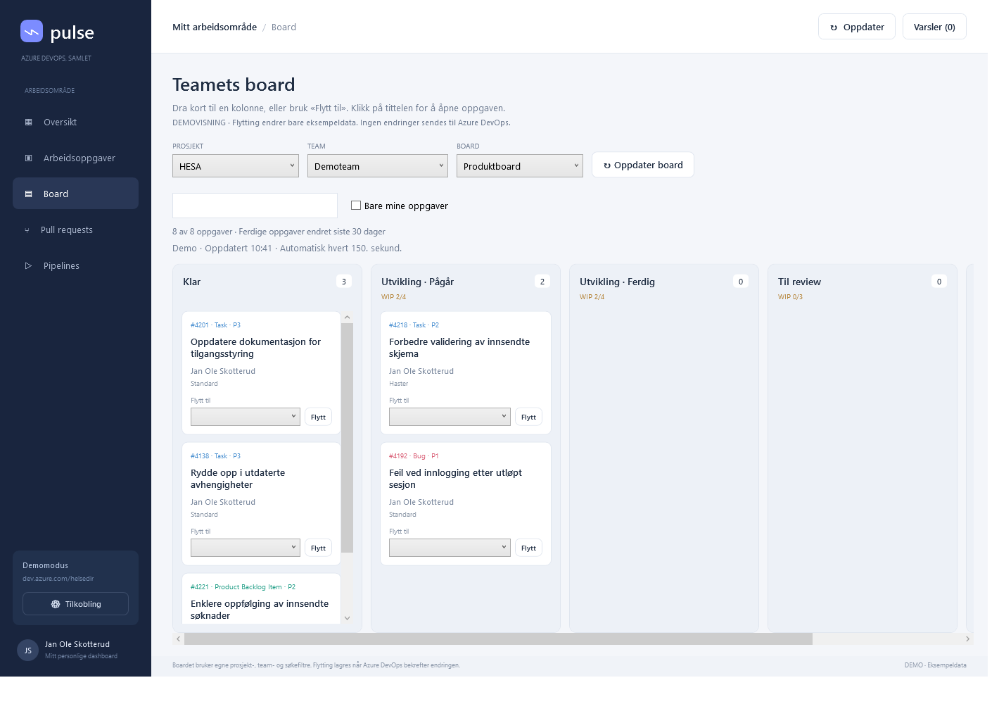
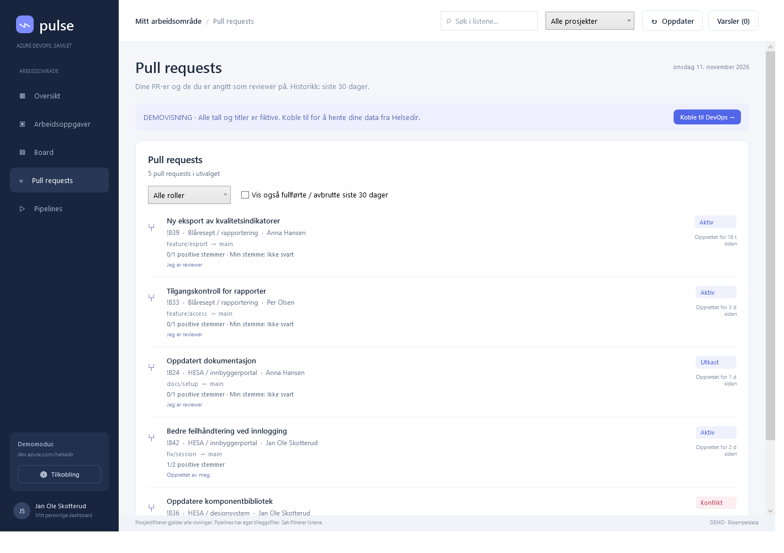
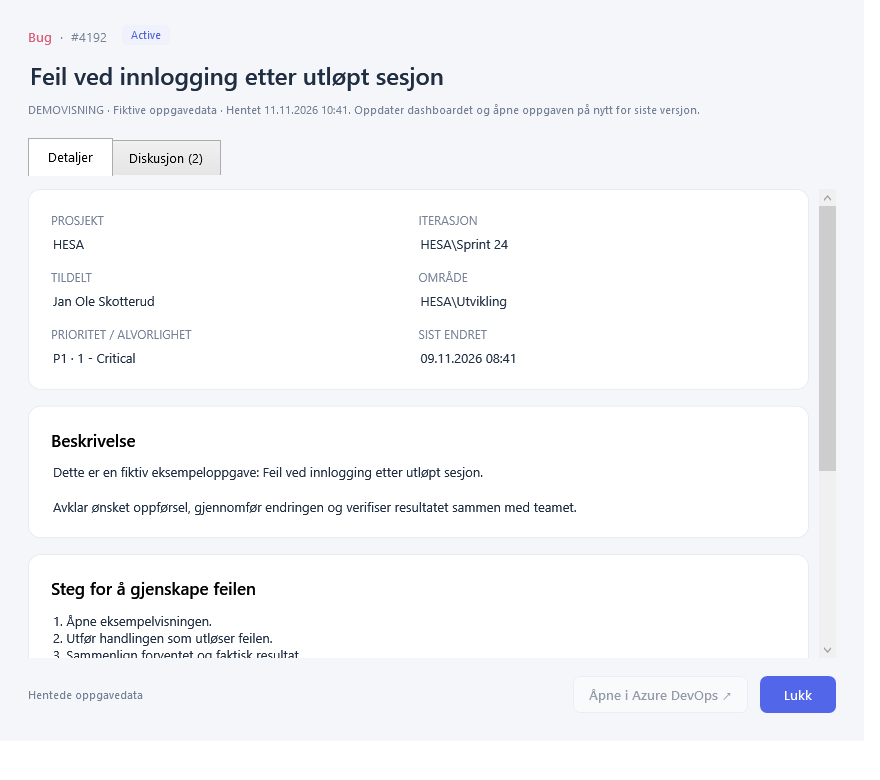
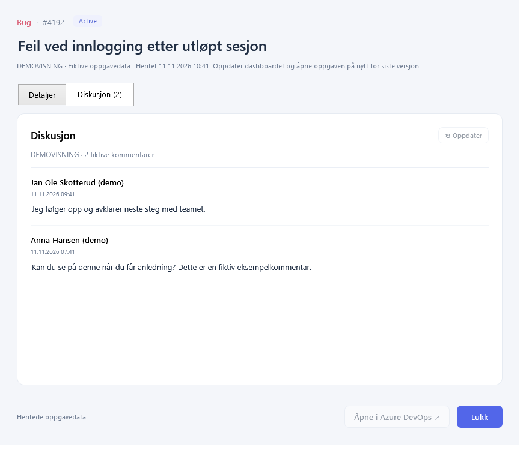

# AdsDashboard · DevOps Pulse

En Windows-app som samler ditt arbeid i Azure DevOps. Bygget i WPF og .NET 10, uten eksterne NuGet-pakker. Dashboardet leser data. Når du flytter et kort på boardet, lagres kolonne og tilhørende status i Azure DevOps.

## Start

Fra en fersk klone: installer **.NET 10 SDK** på Windows og kjør byggeskriptet fra prosjektmappen:

```powershell
.\scripts\Build.ps1
```

Dette oppretter `dist/current/` og `dist/Launch-Pulse.cmd`. Ferdigbygde filer ligger ikke i Git-repoet. Repoet heter **AdsDashboard**; programmet og kjørbar fil heter fortsatt **DevOps Pulse** og `DevOpsPulse.exe`.

Dobbeltklikk **Start-Pulse.cmd** etter bygging. Startfilen velger siste bygde utgave gjennom `dist/Launch-Pulse.cmd`. På denne maskinen er nødvendig .NET allerede installert. Andre maskiner trenger Windows og **.NET 10 Desktop Runtime**. Behold filene i utgavemappen sammen. Nye utgaver kan bygges ved siden av en åpen app med `scripts/Build.ps1 -OutputDirectory dist/releases/<utgave>`.

Appen starter med tydelig merkede, fiktive demodata dersom et lagret token ikke finnes. Velg **Koble til DevOps** eller **Tilkobling** i sidemenyen.

1. Organisasjon: `helsedir`.
2. E-post: `jan.ole.skotterud@helsedir.no` (forhåndsutfylt).
3. Opprett et Personal Access Token i [Azure DevOps](https://dev.azure.com/helsedir/_usersSettings/tokens). Velg organisasjonen og **Read** for **Code**, **Build**, **Project and Team**, og **Identity**. **Work Items: Read** gir visning; velg **Work Items: Read & write** for å kunne flytte kort på boardet. Token og bruker må ha tilgang til prosjektene og redigeringstilgang til oppgavene som skal flyttes. Organisasjonens policy kan begrense PAT-bruk.
4. Lim tokenet inn i appens passordfelt og velg **Koble til**. Ikke legg token i kildekode, kommandolinjer eller chat.

**Husk token** lagrer det med Windows DPAPI for innlogget Windows-bruker i `%LOCALAPPDATA%\DevOpsPulse\credential.dat`. Innstillinger uten hemmeligheter ligger i `settings.json` i samme mappe. Uten avkrysning ligger tokenet kun i prosessminnet. **Glem token** sletter den lagrede legitimasjonen, kobler fra og viser demodata. Lukking medfører at ulagret token må legges inn igjen.

## Eksempelbilder

Bildene er generert fra appens demomodus med fiktive oppgaver, kommentarer, pull requests og pipelines. De viser ingen innloggingsnøkler eller innhold hentet fra Azure DevOps.

**Oversikt**



**Board**



**Pull requests**



**Oppgavedetaljer og diskusjon**

| Oppgavedetaljer | Diskusjon |
| --- | --- |
|  |  |

## Oversikten

- **Board:** Velg **Board** i sidemenyen, deretter prosjekt, team og board. HESA velges først når prosjektet finnes, og Blåresept kan velges i prosjektlisten. Boardet har egne prosjekt- og søkefiltre. Det viser teamets oppgaver ut fra konfigurerte områder, backlog-iterasjon og oppgavetyper i boardets statuskoblinger. Oppgaver i ferdigkolonner vises når de er endret siste 30 dager. Dette er en Kanban-visning; Tasks vises når det valgte boardet støtter denne typen.
- **Flytt kort:** Dra et kort til en kolonne, eller velg mål i **Flytt til** på kortet og trykk **Flytt**. Delte kolonner viser egne Pågår/Ferdig-halvdeler. Status velges fra Azure DevOps-oppsettet for oppgavetypen. Svømmebane, tildeling og rangering beholdes. WIP viser samlet antall i en kolonne mot grensen, også når kolonnen er delt. Omorganisering av rangering eller svømmebaner inngår ikke. Kort uten entydig kolonne vises under **Uten kolonne**.
- **Lagring og feil:** Appen tester oppgavens revisjon før skriving. Kortet flyttes i visningen etter et bekreftet serversvar. Ved manglende tilgang, påkrevde felter, revisjonskonflikt eller ukjent resultat vises en melding, og du må oppdatere boardet før neste forsøk. Skrivekall gjentas ikke automatisk. I demomodus skjer flytting bare i eksempeldata. **Oppdater board** henter på nytt; synlige boards oppdateres også hvert 150. sekund.

- **Arbeidsoppgaver:** Tasks, Features, Bugs og Product Backlog Items tildelt e-postadressen, på tvers av tilgjengelige prosjekter. Søk på ID, tittel, type, status, prosjekt eller iterasjon. Filtrer på type og vis eventuelt ferdige oppgaver. Product Backlog Items har grønt symbol og en egen søyle i oversikten, og inngår i nøkkeltall og ferdigandel.
- **Detaljvindu:** Klikk på en oppgave for å åpne den i et eget vindu i appen. Flere oppgaver kan være åpne samtidig. Vinduet viser tittel, status, prioritet, tildeling, område, beskrivelse, etiketter og eventuelle akseptansekriterier og reproduksjonssteg. Beskrivelser vises som markerbar tekst. **Åpne i Azure DevOps ↗** åpner oppgaven i standardnettleseren og beholder detaljvinduet åpent. Knappen er deaktivert for demodata eller manglende lenke. Dataene er fra siste dashboardoppdatering; hent på nytt og åpne oppgaven igjen for nyeste versjon. Lukk med knappen eller Escape.
- **Diskusjon:** En egen fane i detaljvinduet viser kommentarer med forfatter og opprettelses-/redigeringstid. Kommentarer vises med de nyeste først og hentes ved første åpning og med **Oppdater**. Alle sider leses; slettede kommentarer utelates. Feil og tom diskusjon vises forskjellig, og mislykket oppdatering beholder tidligere kommentarer. Nettknappen er tilgjengelig mens diskusjonen lastes. Work Items (Read) er tilstrekkelig. Dette er lesevisning; nye kommentarer kan skrives på nettsiden.
- **Varsler:** **Varsler (n)** øverst åpner innboksen. Nye tildelinger og @omtaler gir også et skrivebordsvarsel mens appen kjører, inkludert når hovedvinduet er minimert. Du kan slå av skrivebordsvarsler i innboksen. Sjekken følger dashboardets oppdatering hvert 2,5. minutt (150 sekunder), og **Oppdater** sjekker manuelt. Første vellykkede henting etablerer et utgangspunkt uten varsler om gammel aktivitet. Innlogging, bytte av konto eller omstart etablerer et nytt utgangspunkt. Innboksen beholder de siste 200 hendelsene i minnet; åpning markerer dem som lest.
- **Varslingsomfang:** Nye tildelinger gjelder de fire oppgavetypene i dashboardet. @omtaler sjekkes i endrede, tilgjengelige arbeidsoppgaver i alle prosjekter, også når oppgaven er tildelt noen andre. Prosjektfilteret skjuler ikke personlige varsler. Identitetstagger i tittel, beskrivelse, reproduksjonssteg og akseptansekriterier sammenlignes med forrige kontrolltidspunkt. Kommentarenes @omtaler leses fra kommentar-API-et; en ny eller nylig redigert kommentar med din omtale varsles én gang per kommentar per økt. Vanlig e-posttekst regnes ikke som tagging; eksplisitt `@e-postadresse` støttes. PR-diskusjoner, wiki og aktivitet mens appen er lukket inngår ikke. Varsling er avhengig av nettverk, lesetilgang og at Azure DevOps registrerer endringen på oppgaven; feil vises i innboksen og kontrollen forsøkes på nytt. Tildeling og fjerning mellom to kontroller kan ikke oppdages fra øyeblikksbilder.
- **Pull requests:** Opprettet av deg eller med deg direkte angitt som reviewer. Alle aktive, samt fullførte og avbrutte som ble lukket siste 30 dager. Filtrer på rolle, se dine og andres stemmer, utkast og mergekonflikter. Hold pekeren over stemmeteksten for navn og påkrevde reviewers. Positive stemmer er ikke en bekreftelse på at alle branch policies er oppfylt. Indirekte review gjennom gruppemedlemskap er ikke beregnet.
- **Pipelines:** Siste kjøring per byggdefinisjon blant bygg kølagt siste 7 dager. Standardutvalget er **HESA og Blåresept**. Velg et enkeltprosjekt eller **Alle prosjekter** i filteret **Pipelineprosjekter** for å endre utvalget. Dette er prosjektstatus, ikke bare bygg utløst av deg. Gamle feil erstattes av nyere vellykkede kjøringer. Release-pipelines og deployments inngår ikke.
- **Verdt å følge opp:** PR-er uten din stemme (utkast utelatt), kritiske bugs (prioritet 1 eller alvorlighet 1), mergekonflikter, åpne oppgaver uendret i over 7 dager, og siste pipelinekjøringer med feil.
- **Visualiseringer:** Ferdigandel av alle tildelte oppgaver, og fordeling av åpne oppgaver på Task, Feature, Bug og Product Backlog Item. `Closed`, `Done`, `Completed` og `Removed` regnes som ferdig; `Resolved` er fortsatt åpen. Egendefinerte sluttilstander må eventuelt legges til i `Presentation.Done`.

Prosjektfilteret øverst gjelder nøkkeltall, innsikt og alle lister. Velg **HESA og Blåresept** for å se begge prosjektene samlet også for oppgaver og PR-er, eller velg ett av prosjektene. Pipelinefilteret kombineres med dette filteret: et prosjekt må være inkludert i begge for at byggene skal vises. Prosjektnavn matches uten hensyn til store og små bokstaver; gruppen godtar også `Blaaresept` og `Blaresept`. Hvis prosjektene ikke er tilgjengelige, vises et tomt utvalg. Søket filtrerer listene. Oversikten viser inntil 5 oppgaver, 4 PR-er og 3 pipelines; **Se alle** åpner fullstendig liste. Filtre for type, ferdige oppgaver og PR-historikk brukes bare på detaljsidene.

Appen oppdaterer ved tilkobling og hvert 2,5. minutt (150 sekunder). Oppdateringsfeil beholder sist hentede data med tydelig feilmelding og tidspunkt. Manglende tilgang til enkelte prosjekters PR-er eller bygg gir varsel om ufullstendige data, mens tilgjengelige data fortsatt vises. Ingen ekte data mellomlagres på disk. Store organisasjoner kan nå tre minutters grense for en oppdatering. WIQL har en tjenestegrense på 20 000 treff; en overskridelse vises som hentefeil. Bare personens direkte oppgavetildeling og reviewer-rolle inkluderes.

## Bygg og kontroller

```powershell
powershell -ExecutionPolicy Bypass -File scripts/Build.ps1
# Lag også PNG-forhåndsvisninger og kjør UI-sjekkene:
powershell -ExecutionPolicy Bypass -File scripts/Build.ps1 -Preview
```

Forhåndsvisninger legges i `dist/current/previews/` med standard utmappe, eller i `<OutputDirectory>/previews/` når du velger en annen mappe. `-Preview` kjører også innebygde UI-kontroller mot demodata. Utvalgte bilder er kopiert til `docs/images/` for README. Bygget er framework-dependent og trenger ingen nedlasting av NuGet-pakker. `NuGet.Config` har derfor ingen pakkekilder.

## Lokal konfigurasjon og hemmeligheter

Prosjektet bruker ingen `appsettings`-filer i dag. `.gitignore` utelater `appsettings*.json` og sikkerhetskopier av disse i alle mapper, samt `.env`-filer, `credential.dat` og private nøkkel-/sertifikatfiler. Byggeutdata og lokale logger utelates også. Ikke legg PAT-er eller andre hemmeligheter i kildekode, dokumentasjon, eksempelbilder eller Postman-filer. Postman-eksemplenes `test-token` er kun en syntetisk testverdi; den lagrede produksjonslegitimasjonen hører hjemme i appens DPAPI-lager utenfor repoet.

API-integrasjonen er basert på [WIQL](https://learn.microsoft.com/en-us/rest/api/azure/devops/wit/wiql/query-by-wiql?view=azure-devops-rest-7.1), [Work Items Batch](https://learn.microsoft.com/en-us/rest/api/azure/devops/wit/work-items/get-work-items-batch?view=azure-devops-rest-7.1), [Pull Requests by Project](https://learn.microsoft.com/en-us/rest/api/azure/devops/git/pull-requests/get-pull-requests-by-project?view=azure-devops-rest-7.1), [Identities](https://learn.microsoft.com/en-us/rest/api/azure/devops/ims/identities/read-identities?view=azure-devops-rest-7.1), [Projects](https://learn.microsoft.com/en-us/rest/api/azure/devops/core/projects/list?view=azure-devops-rest-7.1) og [Builds](https://learn.microsoft.com/en-us/rest/api/azure/devops/build/builds/list?view=azure-devops-rest-7.1). Kontrakten ligger i `postman/specs/azure-devops.yaml`.

Se [TESTING.md](TESTING.md) for gjentakbare, lokale tester og begrensninger. Tilkobling mot ekte Helsedir-data krever brukerens token og er ikke verifisert her.
